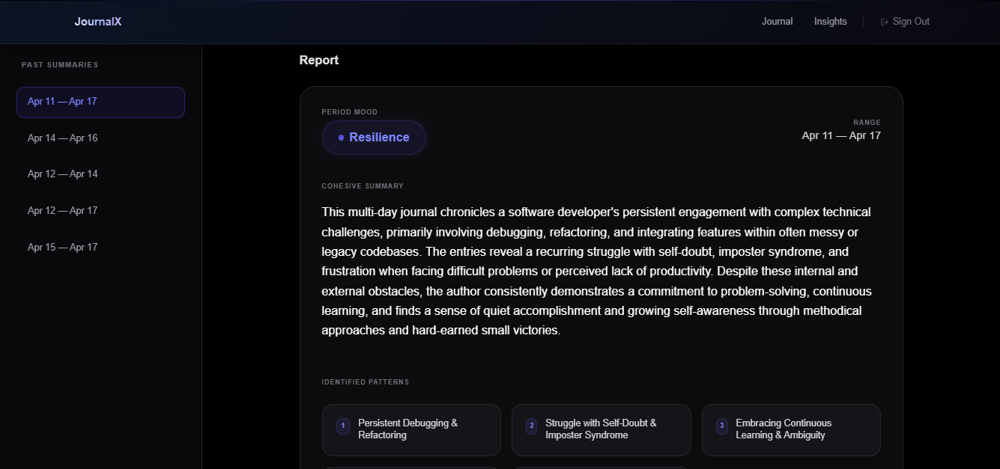

# JournalX 🧠

> Journaling that looks back at you.

<div align="center">
  
</div>

## Overview

**Built a privacy-first AI journaling platform** that turns raw, scattered thoughts into an intelligent personal memory system without compromising data privacy. While most journals become static graveyards of forgotten entries, JournalX protects every thought at rest with AES-256-GCM encryption and uses a multi-tenant vector RAG engine to let you converse with your past self—surfacing recurring habits, mental patterns, and personal growth with exact historical citations.

---

## Key Features

- 🧠 **Conversational Memory Retrieval (RAG):** Ask open-ended questions across your past entries (`/reflect`). Asymmetric semantic search retrieves relevant chunks via Pinecone and synthesizes answers with exact journal date citations.
- 🔒 **AES-256-GCM Encryption at Rest:** Every journal entry is encrypted before hitting MongoDB using a unique 12-byte initialization vector (IV) and a 16-byte authentication tag for tamper resistance. Raw thoughts are never stored in plaintext.
- ⚡ **Zero-Ghost Vector Synchronization:** A 45-second debounced ETL pipeline that re-chunks text upon save and cascades a purge of obsolete vectors upon edits, preventing phantom retrieval.
- 🏢 **Multi-Tenant Vector Isolation:** Pinecone namespaces isolate each user's vector embeddings into private partitions (`.namespace(userId)`), ensuring strict multi-user privacy.
- ✍️ **Distraction-Free TipTap Workspace:** Real-time rich-text editor with automatic weather metadata capture, dynamic ordinal titles, and a chronological sidebar timeline.
- 💾 **Atomic Daily Autosave:** Compound MongoDB index `{ userId, dateKey }` strictly enforces one entry per day with race-condition-free atomic upserts.
- 🛡️ **Stateless Session Security:** Passwords hashed with `bcryptjs` and auto-generated salts. Authentication runs via 7-day JWTs stored in secure `HttpOnly` cookies, shielding sessions against XSS attacks.

---

## User Flow

1. **✍️ Write with Total Privacy (Capture):** Dump your raw thoughts into the distraction-free editor. As you type, your entry is encrypted on-the-fly with AES-256-GCM and atomically saved—no manual saving needed.
2. **⚡ Silent Background Indexing (Sync):** Without any UI lag, the background worker cleans the text, generates 768-dimensional embeddings, and syncs them into your private Pinecone partition.
3. **💬 Ask Your Past Self Anything (Query):** Navigate to `/reflect` and ask natural questions about your life, habits, or recurring hurdles (e.g., *"When did I feel most burned out, and how did I overcome it?"*).
4. **🎯 Receive Grounded, Cited Answers (Synthesize):** The engine semantically searches your personal history and synthesizes an empathetic response—grounded with **exact journal date citations** so you can trace your growth.

---

## Tech Stack

* **Frontend:** Next.js 15 (App Router), React 19, TipTap Rich-Text Editor, Tailwind CSS, Framer Motion, Lucide Icons
* **Backend:** Node.js, Express, TypeScript, AES-256-GCM (`crypto`), JWT in `HttpOnly` Cookies
* **Database:** MongoDB & Mongoose
* **Vector Database:** Pinecone (Multi-tenant per-user namespace isolation)
* **AI & Embeddings:** Google Gemini 2.5 Flash & `gemini-embedding-2`

---

## Getting Started

### Prerequisites

* **Node.js:** v18.0.0 or higher
* **MongoDB:** Local instance or MongoDB Atlas cluster
* **Google Gemini API Key:** For embeddings and conversational synthesis
* **Pinecone API Key & Index:** Configured for 768 dimensions with cosine metric

---

### Run Locally

1. **Clone the repository:**
   ```bash
   git clone https://github.com/cyphering101Raman/JournalX.git
   cd JournalX
   ```

2. **Configure and start the Backend:**
   ```bash
   cd backend
   npm install
   ```
   Create a `.env` file in `backend/`:
   ```env
   PORT=5000
   MONGODB_URI=mongodb+srv://<username>:<password>@cluster.mongodb.net/journalx
   JWT_SECRET=your_jwt_secret_key
   ENCRYPTION_KEY=your_32_character_aes_encryption_key
   GEMINI_API_KEY=your_gemini_api_key
   PINECONE_API_KEY=your_pinecone_api_key
   PINECONE_INDEX_NAME=journalx
   FRONTEND_URL=http://localhost:3000
   ```
   Start the backend development server:
   ```bash
   npm run dev
   ```

3. **Configure and start the Frontend:**
   ```bash
   cd ../frontend
   npm install
   ```
   Create a `.env.local` file in `frontend/`:
   ```env
   NEXT_PUBLIC_API_URL=http://localhost:5000
   ```
   Start the frontend development server:
   ```bash
   npm run dev
   ```
   Open [http://localhost:3000](http://localhost:3000) in your browser.

---

## Upcoming Roadmap

- 📊 **Hierarchical 15-Day Rollups:** Zero-token mood/energy trend graphs and multi-day synthesis without context limits.
- ☁️ **Cloud Persistence for Reflect History:** Cross-device sync for conversational Q&A threads (`/api/v1/rag/history`).
- 🎙️ **Voice Journaling:** Native audio capture with multi-modal transcription.
- 📞 **Conversational Voice Call Agent:** Call an empathetic AI companion to speak your heart out; on call disconnect, the session is structured, AES-encrypted, indexed into Pinecone, and confirmed via WhatsApp.
- 💬 **WhatsApp Sync & Voice Notes:** Send quick texts or voice notes on WhatsApp to seamlessly append to your daily entry and update your vector memory without opening the web app.


---

## Product Showcase

### Distraction-Free Workspace
A minimal, premium environment that auto-saves your thoughts and analyzes them in real-time.

<div align="center">
  
</div>
<br/>

### AI-Powered Reflection & Analytics
Extract a single-word mood and a concise summary instantly. Zoom out to see emotional trends and recurring patterns over customized date ranges.

<div align="center">
  
</div>
<br/>
<div align="center">
  
</div>

---
*Built for growth. Built for clarity.*
